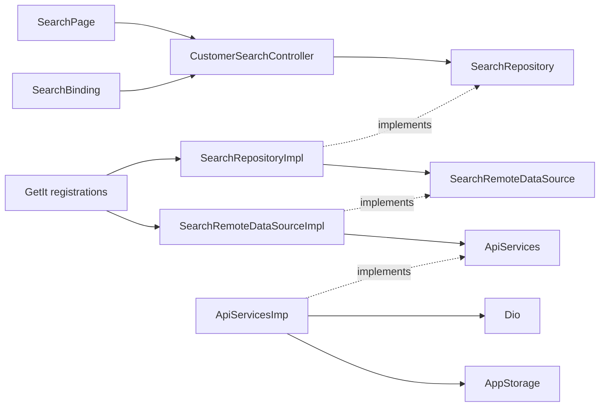

# Feature-first architecture

## Purpose and scope

Describe actual dependencies and boundaries in the reference stack.

## Rules and decision criteria

- **ARCH-001 MANDATORY** For API-backed features, call a repository contract from a controller, implement it against a data source contract, and parse transport data in the data source through the shared API service.
- **ARCH-002 DEFAULT** Put pages, widgets, controllers, and bindings directly under a feature root. Add `domain/repository` and `data/{remote,repository,models}` for owned APIs. Shared data infrastructure lives under `data/datasource`. Shared platform and UI facilities live under `core`. Route arguments and display mappers may live under feature `models` and `mappers`.
- **ARCH-003 RECOMMENDED** Audit import direction and ownership when creating shared code. Feature widgets can import state, models and UI primitives. Controllers can import repository contracts and narrow service contracts. Repositories can import data-source contracts, response types and error mapping. Data sources can import API services and serializers. Keep reverse imports, UI in remote code, and implementation lookup in widgets out of the graph. The source has no verified cycle gate.

## Implementation workflow and validation

Walk each dependency from route registration to the transport implementation. Return parsed data through ApiResponse and drive reactive rendering in the controller. Omit repository and remote layers for a static page. Add use cases only when the target architecture justifies them.

## Source evidence

High confidence from the Search chain and the FAQ chain. `lib/data/datasource/configuration/locator.dart` registers search around lines 423–435 and FAQ around 464–474. The domain/data coupling is visible in both repository interfaces.

## Related skills

[State and DI](../../../state-management/getx/STATE_ARCHITECTURE.md) · [Feature workflow](FEATURE_WORKFLOW.md)
