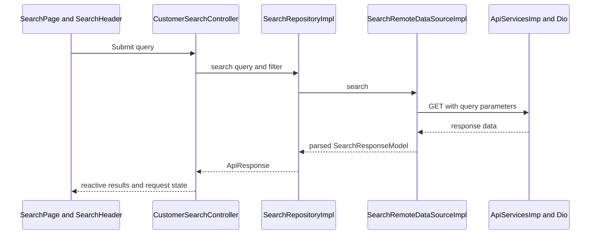

# Connect an API

## Purpose and scope

Wire a documented endpoint from request model to rendering.

## Rules and decision criteria

- Apply **ARCH-001**, **DI-001**, **STATE-001**, and **API-001** through **API-005** when relevant.
- Confirm method, version, auth policy, input types and encoding, envelope, status mapping, retry policy, and pagination semantics.

## Implementation workflow and validation

| Order | File under lib | Action |
| --- | --- | --- |
| 1 | `core/utils/app_url.dart` | Add the confirmed endpoint constant or ID builder. |
| 2 | `features/name/data/models/` | Define typed request parameters, body, and parsed response. |
| 3 | `features/name/data/remote/` | Define the data source contract, call the gateway, parse JSON. |
| 4 | `features/name/domain/repository/` and `data/repository/` | Add public operation and wrap success and failures. |
| 5 | `data/datasource/configuration/locator.dart` | Register source and repository interfaces. |
| 6 | `features/name/controller/` and `binding/` | Inject repository, update state safely, and close resources. |
| 7 | `features/name/pages/`, `widgets/`, `core/routes/`, `locale/` | Connect UI callbacks, register the route binding, and translate state copy. |

Verify a successful call from the real route. Exercise a valid empty result, bad payload, status failures, offline and timeout, and retry. Test auth omission for public endpoints and state after route disposal. For paging or search test two responses arriving in reverse order. Avoid parsing maps in the page, resolving repositories from widgets, and swallowing failed envelopes because the HTTP status was successful.

## Source evidence

High confidence. `lib/features/search/controller/search_controller.dart` search, `data/repository/search_repository_impl.dart` search and `data/remote/search_remote_data_source_impl.dart` search in the same feature. Guest branch selects a different endpoint and translates the response.

## Related skills

[Networking](../../../core/networking/profiles/dio/API_GATEWAY.md) · [Tasks example](examples/TASKS_FEATURE.md)
