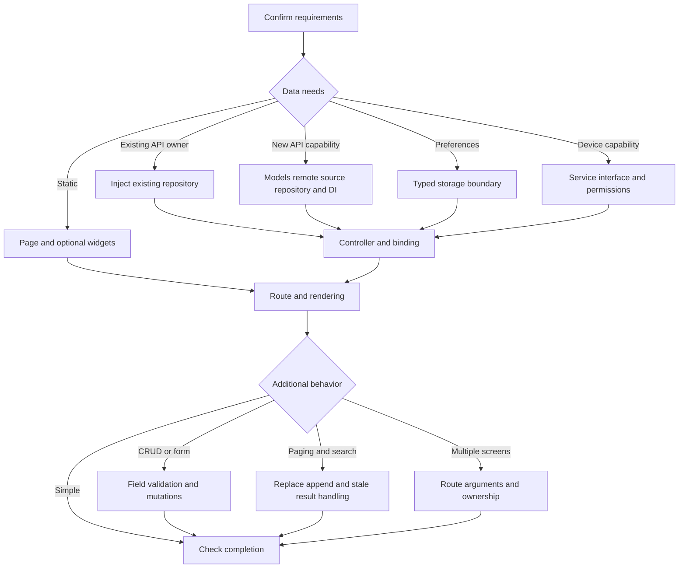

# Feature workflow for the reference architecture

The route and controller instructions apply to the verified GetX pairing. For a new project, use the [decision workflow](../../../project-setup/PROJECT_DECISION_WORKFLOW.md) first.

## Purpose and scope

Start at requirement and contract discovery. Finish at a verified normal entry point.

## Rules and decision criteria

- **FEATURE-001 MANDATORY** Define outcomes, routes, owners, API contracts and success/empty/error behavior first. Choose dependencies according to the diagram and preserve existing feature ownership.
- **FEATURE-002 DEFAULT** Build inside-out for remote features. Define the contract and models, implement the remote adapter and repository, register the services, then build controller, binding, page and route.
- **FEATURE-003 CONDITIONAL** Forms get field validation and mutation state. Pagination gets explicit page metadata, append state and refresh reset. Multi-screen flows get typed IDs or arguments and a controller scope matched to the operation. Local preference flows get typed storage methods. Device features get wrappers and platform declarations.

## Implementation workflow and validation

1. List entry points, permissions, route arguments, visuals, locale keys and error recovery. Decide which data is owned and which is reused.
2. For each API operation define request types, response and paging metadata. Combine endpoints on a shared repository when they represent the same capability. Start independent requests concurrently only when their inputs and results are independent.
3. Register the contract implementations, then add a controller with initial, loaded, empty and failure paths. Compose small screen sections. Add translations and assets, then register GetPage against AppRoutes.
4. When modifying an existing feature, trace all callers first. Preserve stored keys, route arguments and result formats. Limit changes to the relevant owner.
5. Verify fresh entry, existing data, empty and backend failures, repeated taps, retry, refresh, route exit and reentry, RTL and constrained viewport. Check a successful mutation updates or reloads the correct view.

## Source evidence

High confidence for pattern. FAQ owns its endpoint, Search injects separate filter dependencies, and delivery_schedule contains only pages. About App, shell and support subflows illustrate why the same folder list is not universal.

## Related skills

[Connect API](CONNECT_API.md) · [Decisions](../../../core/coding-standards/DECISIONS.md)
